# Diagrama de clases – Módulo 1: Historial Médico

**Proyecto:** VetManage · **Grupo:** 1 · **Versión:** 2.0 (17-11-2026)
**Base:** historias de usuario HU-01 a HU-61 del Módulo 1 (incluye Autenticación y Autorización).

Este es el diagrama de clases lógico del Módulo 1. VetManage es un monolito, así que es un solo modelo de dominio: los Módulos 2 (Agendamiento de citas) y 3 (Inventario y ventas) parten de estas mismas clases y agregan las suyas.

## 1. Notación UML usada

| Símbolo | Relación | Significado |
|---|---|---|
| `<\|--` (triángulo vacío) | Generalización | La clase hija **es un** tipo de la clase padre y hereda sus atributos, métodos y relaciones. |
| `*--` (rombo negro) | Composición | La parte no existe sin el todo. Si se elimina el todo, desaparecen sus partes. |
| `o--` (rombo vacío) | Agregación | La parte pertenece al todo, pero puede existir sin él. |
| `-->` (flecha) | Asociación dirigida | Una clase conoce a la otra. |
| `--` (línea) | Asociación | Relación en ambos sentidos. |

- Cada relación lleva su **nombre** y su **multiplicidad** en los dos extremos (`1`, `0..1`, `0..*`, `1..*`).
- `[0..1]` junto a un atributo indica que es **opcional**.
- Las referencias a `Usuario` que solo dicen **quién hizo algo** (por ejemplo `-realizadoPor: Usuario [1]`) se escriben como atributo y no como línea. En UML significan lo mismo que una asociación; se escriben así para que el diagrama no se llene de líneas hacia `Usuario`.

## 2. Diagrama

```mermaid
classDiagram
  direction LR
  class Persona {
    -cedula: String
    -nombres: String
    -apellidos: String
    -telefono: String [0..1]
    -correo: String
    +actualizarDatos(datos) void
  }
  class Usuario {
    -clave: String
    -estado: EstadoRegistro
    -fechaBaja: DateTime [0..1]
    -motivoBaja: String [0..1]
    +iniciarSesion(correo, clave) Boolean
    +cambiarClave(actual, nueva) void
    +recuperarClave() void
    +asignarRol(rol) void
    +quitarRol(rol) void
    +activar() void
    +inactivar() void
    +darDeBaja(motivo) void
  }
  class Rol {
    -nombre: String
    -descripcion: String
    +asignarPermiso(permiso) void
    +quitarPermiso(permiso) void
  }
  class Permiso {
    -nombre: String
    -descripcion: String
  }
  class Auditoria {
    -fechaHora: DateTime
    -rol: String
    -accion: String
    -modulo: String
    -registroAfectado: String
  }
  class Cliente {
    -direccion: String [0..1]
    -estado: EstadoRegistro
    -fechaBaja: DateTime [0..1]
    -motivoBaja: String [0..1]
    +activar() void
    +inactivar() void
    +darDeBaja(motivo) void
  }
  class Paciente {
    -codigoIdentificador: String
    -nombre: String
    -genero: Genero
    -color: String [0..1]
    -fechaNacimiento: Date
    -peso: Decimal
    -talla: Decimal
    -estadoReproductivo: EstadoReproductivo
    -estado: EstadoRegistro
    -fechaBaja: DateTime [0..1]
    -motivoBaja: String [0..1]
    +actualizarDatos(datos) void
    +activar() void
    +inactivar() void
    +darDeBaja(motivo) void
  }
  class Especie {
    -nombre: String
    -descripcion: String [0..1]
    -estado: EstadoCatalogo
    +activar() void
    +inactivar() void
  }
  class Raza {
    -nombre: String
    -descripcion: String [0..1]
    -estado: EstadoCatalogo
    +activar() void
    +inactivar() void
  }
  class HistoriaClinica {
    -numeroHistoria: String
    -antecedentes: String
    -estadoActual: String
    -fechaHoraRegistro: DateTime
    -registradaPor: Usuario [1]
    +registrarAntecedentes(texto) void
    +corregirAntecedentes(motivo, texto) void
    +consultarLineaDeTiempo() List
  }
  class ActoClinico {
    <<abstract>>
    -fechaHoraRegistro: DateTime
    -observaciones: String [0..1]
    -estado: EstadoActo
    -realizadoPor: Usuario [1]
    +finalizar() void
    +registrarCorreccion(motivo, descripcion) void
  }
  class AtencionClinica {
    -razonCita: String
    -diagnostico: String
  }
  class ProcedimientoClinico {
    -horaInicio: Time
    -horaFin: Time
  }
  class NotaCorreccion {
    -motivo: String
    -descripcion: String
    -fechaHora: DateTime
    -redactadaPor: Usuario [1]
  }
  class Receta {
    -fechaEmision: DateTime
    -indicacionesGenerales: String
    -observaciones: String [0..1]
    -estado: EstadoReceta
    +agregarMedicamento(detalle) void
    +retirarMedicamento(detalle) void
    +generarPDF() void
  }
  class DetalleReceta {
    -medicamento: String
    -presentacion: String
    -concentracion: String [0..1]
    -viaAdministracion: String
    -frecuencia: String
    -duracion: String
  }
  class Cantidad {
    -valor: Decimal
    -unidad: UnidadDosis
  }
  class InsumoUtilizado {
    -cantidad: Integer
  }
  class ArchivoClinico {
    -nombre: String
    -descripcion: String [0..1]
    -formato: FormatoArchivo
    -tamanioMB: Decimal
    -fechaCarga: DateTime
    -estado: EstadoArchivo
    -motivoRetiro: String [0..1]
    -cargadoPor: Usuario [1]
    -retiradoPor: Usuario [0..1]
    +visualizar() void
    +descargar() void
    +actualizarInformacion(nombre, descripcion) void
    +retirar(motivo) void
  }
  class AplicacionPreventiva {
    <<abstract>>
    -fechaAplicacion: Date
    -lote: String
    -fechaProxima: Date [0..1]
    -observaciones: String [0..1]
    -fechaHoraRegistro: DateTime
    -estado: EstadoAplicacion
    -motivoAnulacion: String [0..1]
    -aplicadaPor: Usuario [1]
    +editar(datos) void
    +anular(motivo) void
  }
  class Vacunacion {
    -vacuna: String
    -laboratorio: String
  }
  class Desparasitacion {
    -tipo: TipoDesparasitacion
    -producto: String
  }
  class CambioRegistro {
    -campo: String
    -valorAnterior: String
    -valorNuevo: String
    -fechaHora: DateTime
    -realizadoPor: Usuario [1]
  }
  class TipoProcedimiento {
    -nombre: String
    -descripcion: String
    -estado: EstadoCatalogo
    +activar() void
    +inactivar() void
  }
  class Procedimiento {
    -nombre: String
    -descripcion: String
    -precioBase: Decimal
    -requisitosPrevios: String
    -requiereHospitalizacion: Boolean
    -estado: EstadoCatalogo
    +activar() void
    +inactivar() void
  }
  class InsumoRequerido {
    -cantidad: Integer
  }
  class Insumo {
    -nombre: String
    -descripcion: String
  }
  class Cita {
    -fechaHora: DateTime
    -motivo: String
    -estado: String
  }
  note for Cita "Clase del Módulo 2 (Agendamiento de citas). Solo se muestran los atributos que usa el Historial Médico."
  note for Insumo "Clase del Módulo 3 (Inventario y ventas). Solo se muestran los atributos que usa el Historial Médico."

  Usuario "0..1" --> "1" Persona : perteneceA
  Cliente "0..1" --> "1" Persona : esUna
  Usuario "0..*" --> "1..*" Rol : tiene
  Rol "0..*" -- "1..*" Permiso : otorga
  Auditoria "0..*" --> "1" Usuario : registraAccionDe
  Cliente "1" o-- "0..*" Paciente : esDueñoDe
  Paciente "0..*" --> "1" Raza : esDe
  Raza "0..*" --> "1" Especie : perteneceA
  Paciente "1" *-- "1" HistoriaClinica : tiene
  HistoriaClinica "1" *-- "0..*" ActoClinico : registra
  HistoriaClinica "1" *-- "0..*" AplicacionPreventiva : registra
  HistoriaClinica "1" *-- "0..*" NotaCorreccion : antecedentesCorregidosCon
  ActoClinico <|-- AtencionClinica
  ActoClinico <|-- ProcedimientoClinico
  AplicacionPreventiva <|-- Vacunacion
  AplicacionPreventiva <|-- Desparasitacion
  AtencionClinica "0..1" --> "1" Cita : atiende
  AtencionClinica "0..1" -- "0..*" ProcedimientoClinico : origina
  ProcedimientoClinico "0..*" --> "0..1" Cita : programadoEn
  ProcedimientoClinico "0..*" --> "1" Procedimiento : ejecuta
  Procedimiento "0..*" --> "1" TipoProcedimiento : clasificadoEn
  Procedimiento "1" *-- "0..*" InsumoRequerido : requiere
  InsumoRequerido "0..*" --> "1" Insumo : de
  ActoClinico "1" *-- "0..*" NotaCorreccion : corregidoCon
  ActoClinico "1" *-- "0..1" Receta : prescribe
  Receta "1" *-- "0..*" DetalleReceta : contiene
  DetalleReceta "1" *-- "1" Cantidad : dosis
  ActoClinico "1" *-- "0..*" InsumoUtilizado : consume
  InsumoUtilizado "0..*" --> "1" Insumo : de
  ActoClinico "1" *-- "0..*" ArchivoClinico : adjunta
  AplicacionPreventiva "1" *-- "1" Cantidad : dosis
  AplicacionPreventiva "1" *-- "0..*" CambioRegistro : historialDeCambios
```

## 3. Enumeraciones

```mermaid
classDiagram
  direction LR
  class EstadoRegistro {
    <<enumeration>>
    Activo
    Inactivo
    DadoDeBaja
  }
  class EstadoCatalogo {
    <<enumeration>>
    Activo
    Inactivo
  }
  class Genero {
    <<enumeration>>
    Macho
    Hembra
  }
  class EstadoReproductivo {
    <<enumeration>>
    Esterilizado
    NoEsterilizado
    Desconocido
  }
  class EstadoActo {
    <<enumeration>>
    EnCurso
    Finalizado
  }
  class EstadoReceta {
    <<enumeration>>
    EnElaboracion
    Emitida
  }
  class EstadoAplicacion {
    <<enumeration>>
    Activa
    Anulada
  }
  class TipoDesparasitacion {
    <<enumeration>>
    Interno
    Externo
    Mixto
  }
  class UnidadDosis {
    <<enumeration>>
    ml
    mg
    tableta
    dosis
  }
  class FormatoArchivo {
    <<enumeration>>
    PDF
    JPG
    PNG
    DICOM
  }
  class EstadoArchivo {
    <<enumeration>>
    Disponible
    Retirado
  }
```

| Enumeración | Valores | Clases que la usan |
|---|---|---|
| `EstadoRegistro` | Activo, Inactivo, DadoDeBaja | Cliente, Paciente, Usuario |
| `EstadoCatalogo` | Activo, Inactivo | Especie, Raza, TipoProcedimiento, Procedimiento |
| `EstadoActo` | EnCurso, Finalizado | AtencionClinica, ProcedimientoClinico |
| `EstadoReceta` | EnElaboracion, Emitida | Receta |
| `EstadoAplicacion` | Activa, Anulada | Vacunacion, Desparasitacion |
| `EstadoArchivo` | Disponible, Retirado | ArchivoClinico |
| `Genero` | Macho, Hembra | Paciente |
| `EstadoReproductivo` | Esterilizado, NoEsterilizado, Desconocido | Paciente |
| `TipoDesparasitacion` | Interno, Externo, Mixto | Desparasitacion |
| `UnidadDosis` | ml, mg, tableta, dosis | Cantidad |
| `FormatoArchivo` | PDF, JPG, PNG, DICOM | ArchivoClinico |

## 4. Estados: activar, inactivar y dar de baja

Son tres acciones distintas:

| Acción | Estado al que pasa | ¿Se puede revertir? | Ejemplo |
|---|---|---|---|
| Inactivar | Inactivo | Sí, con *activar* | Un cliente que deja de venir por un tiempo; un empleado de vacaciones. |
| Activar | Activo | — | El cliente vuelve a la clínica. |
| Dar de baja | DadoDeBaja | **No.** Es definitivo y conserva todo el historial. | Un paciente fallecido; un empleado que ya no trabaja en la clínica. |

- **Cliente, Paciente y Usuario** usan los tres estados (`EstadoRegistro`). Al dar de baja se guardan la fecha y el motivo; quién lo hizo queda en la auditoría.
- **Especie, Raza, TipoProcedimiento y Procedimiento** son catálogos y solo se activan o inactivan (`EstadoCatalogo`), como dicen las HU-15, HU-19, HU-38 y HU-40. Un valor inactivo deja de aparecer en los selectores, pero los registros que ya lo usan no cambian.
- Los registros clínicos no se dan de baja: las vacunas y desparasitaciones se **anulan** (HU-24, HU-28), los archivos se **retiran** (HU-50) y las atenciones, los procedimientos y los antecedentes se **corrigen** con una nota (HU-29, HU-32, HU-42).

## 5. Clases

### 5.1 Personas, cuentas y permisos

| Clase | Qué representa | HU |
|---|---|---|
| `Persona` | Datos de identificación de una persona: cédula (única), nombres, apellidos, teléfono y correo. Una persona se registra una sola vez aunque sea cliente y empleado a la vez. | HU-01, HU-51 |
| `Cliente` | Rol de *cliente* de una persona: dueño de las mascotas. Tiene dirección y estado propios. | HU-01 a HU-06 |
| `Usuario` | Cuenta de acceso de una persona, con su clave, estado y roles. El personal siempre tiene cuenta; el cliente solo si se le permite ingresar. | HU-51 a HU-59, HU-61 |
| `Rol` | Administrador, Gerente, Veterinario, Técnico Veterinario, Recepcionista, Cajero, Bodeguero o Cliente. Una cuenta puede tener varios. | HU-54, HU-56 |
| `Permiso` | Lo que un rol puede hacer (por ejemplo «Registrar cliente»). Lo administra el Administrador. | HU-56 |
| `Auditoria` | Registro de solo lectura de cada acción: fecha y hora, usuario, rol, acción, módulo y registro afectado. | HU-60 |

### 5.2 Pacientes y catálogos

| Clase | Qué representa | HU |
|---|---|---|
| `Paciente` | La mascota. El código identificador lo genera el sistema (por ejemplo PAC-0001). Solo el color es opcional. | HU-07 a HU-12 |
| `Especie` | Catálogo de especies, con descripción opcional. | HU-13 a HU-16 |
| `Raza` | Catálogo de razas. Cada raza pertenece a una especie activa. | HU-17 a HU-20 |
| `HistoriaClinica` | Una por paciente, con número automático, antecedentes y estado actual. Guarda quién la registró y cuándo. | HU-29, HU-33 |

### 5.3 Atención y procedimientos

| Clase | Qué representa | HU |
|---|---|---|
| `ActoClinico` | Abstracta. Lo común a la atención y al procedimiento: fecha y hora, observaciones, estado, responsable, receta, insumos, archivos y correcciones. | HU-30 a HU-32, HU-43 a HU-50 |
| `AtencionClinica` | La consulta. Siempre nace de una cita en estado «En Curso», y una cita tiene como máximo una atención. Guarda la razón de la cita y el diagnóstico. | HU-30, HU-31 |
| `ProcedimientoClinico` | Un procedimiento ejecutado en un paciente, con hora de inicio y fin. Puede salir de una atención o hacerse sin consulta (por ejemplo una cirugía programada con su propia cita). | HU-41 |
| `NotaCorreccion` | Corrección de una atención, de un procedimiento o de los antecedentes. El registro original no se modifica. | HU-29, HU-32, HU-42 |
| `Receta` / `DetalleReceta` | Receta del acto clínico y sus medicamentos (nombre, presentación, concentración, dosis con unidad, vía, frecuencia y duración). Se edita mientras la atención está en curso. | HU-34 a HU-36 |
| `InsumoUtilizado` | Cantidad de un insumo de la farmacia que se usó en un acto clínico. | HU-43, HU-44 |
| `ArchivoClinico` | Archivo PDF, JPG, PNG o DICOM de hasta 50 MB. Retirarlo no lo borra: guarda motivo, fecha y responsable. | HU-45 a HU-50 |
| `TipoProcedimiento` | Clasificación del catálogo (Cirugía, Imagenología…). | HU-37, HU-38 |
| `Procedimiento` | Procedimiento del catálogo, con precio base, requisitos y si requiere hospitalización. | HU-39, HU-40 |
| `InsumoRequerido` | Lista predefinida de insumos y cantidades que exige un procedimiento del catálogo. | HU-39 |

### 5.4 Vacunación y desparasitación

| Clase | Qué representa | HU |
|---|---|---|
| `AplicacionPreventiva` | Abstracta. Lo común: fecha, lote, dosis, próxima fecha, observaciones, responsable y anulación con motivo. | HU-21 a HU-28 |
| `Vacunacion` | Agrega vacuna y laboratorio. | HU-21 a HU-24 |
| `Desparasitacion` | Agrega tipo (Interno, Externo o Mixto) y producto. | HU-25 a HU-28 |
| `Cantidad` | Valor mayor a cero con su unidad. Se usa en la dosis de vacunas, desparasitaciones y medicamentos. | HU-21, HU-25, HU-34 |
| `CambioRegistro` | Una fila por campo modificado (valor anterior, valor nuevo, usuario, fecha y hora). Solo se agregan filas. | HU-22, HU-26 |

### 5.5 Clases de otros módulos

| Clase | Módulo | Uso en este módulo |
|---|---|---|
| `Cita` | Módulo 2 – Agendamiento de citas | La atención se registra sobre una cita «En Curso» y la deja «Finalizada». |
| `Insumo` | Módulo 3 – Inventario y ventas | Los insumos utilizados y requeridos apuntan a él; el Módulo 3 descuenta el stock. |

## 6. Relaciones y multiplicidades principales

| Relación | Tipo | Lectura |
|---|---|---|
| Usuario `0..1` → `1` Persona «perteneceA» | Asociación | Una persona tiene como máximo una cuenta, y cada cuenta es de una persona. |
| Cliente `0..1` → `1` Persona «esUna» | Asociación | Una persona puede ser cliente o no. Si una clienta luego entra a trabajar, se le agrega un rol a su cuenta y no se duplica la persona (HU-51, escenario 3). |
| Usuario `0..*` → `1..*` Rol «tiene» | Asociación | Una cuenta tiene al menos un rol y puede tener varios (por ejemplo Gerente y Administrador). |
| Rol `0..*` — `1..*` Permiso «otorga» | Asociación | Los permisos de un usuario son la suma de los permisos de sus roles. |
| Cliente `1` ◇ `0..*` Paciente «esDueñoDe» | Agregación | Dar de baja al cliente no borra a sus mascotas. |
| Paciente `0..*` → `1` Raza → `1` Especie | Asociación | La especie del paciente se obtiene a través de su raza. |
| Paciente `1` ◆ `1` HistoriaClinica «tiene» | Composición | La historia no existe sin su paciente. |
| HistoriaClinica `1` ◆ `0..*` ActoClinico «registra» | Composición | La historia es la única dueña de las atenciones y los procedimientos. |
| HistoriaClinica `1` ◆ `0..*` AplicacionPreventiva «registra» | Composición | Igual para vacunas y desparasitaciones. |
| AtencionClinica `0..1` → `1` Cita «atiende» | Asociación | Toda atención viene de una cita y una cita genera como máximo una atención. |
| AtencionClinica `0..1` — `0..*` ProcedimientoClinico «origina» | Asociación | Opcional: enlaza el procedimiento con la consulta de la que salió. |
| ProcedimientoClinico `0..*` → `0..1` Cita «programadoEn» | Asociación | Para procedimientos agendados aparte. |
| ProcedimientoClinico `0..*` → `1` Procedimiento «ejecuta» | Asociación | Cada ejecución es de un procedimiento del catálogo. |
| ActoClinico `1` ◆ `0..1` Receta «prescribe» | Composición | La receta es opcional y hay una por acto. |
| ActoClinico `1` ◆ `0..*` InsumoUtilizado «consume» | Composición | Vale para atenciones y procedimientos por herencia. |

## 7. Patrones de análisis aplicados

| Patrón | Dónde | Por qué |
|---|---|---|
| Party y Role (Fowler) | `Persona` con los roles `Cliente` y `Usuario` | Una misma persona puede ser cliente y empleado; sus datos se guardan una sola vez (HU-51 y HU-61, escenarios con «Ana Ruiz»). |
| Control de acceso basado en roles | `Usuario → Rol → Permiso` | Los accesos se cambian asignando permisos o roles, sin tocar el modelo (HU-54, HU-56). |
| Item–Description (Coad) | `Especie/Raza ← Paciente`, `TipoProcedimiento/Procedimiento ← ProcedimientoClinico` | Separa el catálogo de lo que se le hizo a un paciente; inactivar un valor del catálogo no altera lo registrado. |
| Transaction–Line Item (Coad) | `Receta ◆ DetalleReceta`, `ActoClinico ◆ InsumoUtilizado`, `Procedimiento ◆ InsumoRequerido` | Un encabezado con varias líneas, cada una con su cantidad o indicación. |
| Quantity (Fowler) | `Cantidad` (valor + unidad) | La dosis siempre lleva una cantidad mayor a cero y su unidad. |
| Audit Log (Fowler) | `Auditoria`, `CambioRegistro`, `NotaCorreccion` | Los cambios se agregan como registros nuevos; el original nunca se sobrescribe. |
